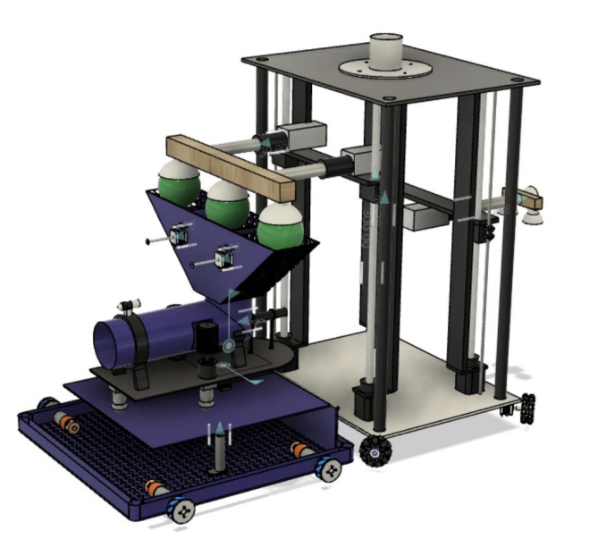
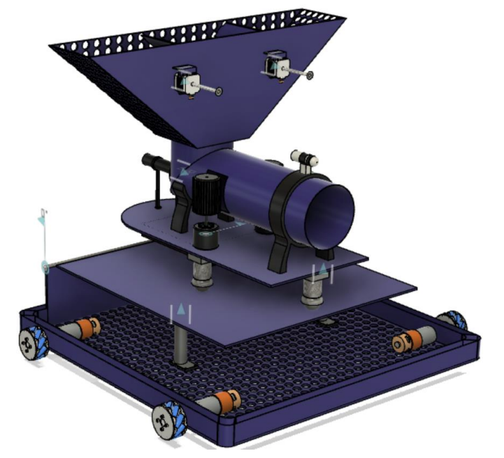
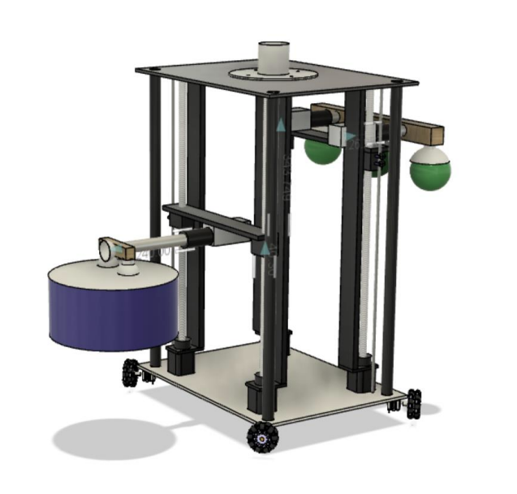

# Robocon-2022

CAD design, Arduino code and wiring of our two robots R1 and R2 for DD Robocon 2022
(theme: Lagori). Both robots were modelled in Fusion 360 and exported as STEP files so
they can be opened in any CAD tool. Both robots are driven by hand with a Bluetooth remote.



## Folder structure

```
cad/r1/r1_body.step    full R1 assembly
cad/r1/parts/          R1 mechanisms and parts
cad/r2/r2_body.step    full R2 assembly
cad/r2/parts/          R2 mechanisms and parts
code/r1/r1.ino         R1 sketch (Arduino Mega)
code/r2/r2.ino         R2 sketch (Arduino Mega)
code/remote/remote.ino handheld remote (Arduino Nano)
images/                renders of both robots
videos/                assembly animations of R1 and R2
docs/parts.md          what each STEP file contains
docs/wiring/           wiring schematics of R1, R2 and the remote
```

## R1 (shooter)



R1 has a hopper-funnel on top that takes all three balls from R2 at once. The middle
ball gets loaded first. The side balls are held in the hopper by two stepper motors
which release them one by one after each shot.

Two linear actuators on the base plate lift the rotating table with the pipe shooter
on it and set the angle of elevation. The ball in the pipe is pushed into the high-RPM
motors that throw it like a baseball pitching machine. Aiming with a camera was
planned but is not part of this repo.

The base runs on four mecanum wheels.

## R2 (picker)



R2 is a tall frame with a platform that moves up and down on stepper driven lead
screws. Suction cups connected to a vacuum pump hold the lagori discs and the balls.
Creating the vacuum grips the part and releasing it drops the part.

For the lagori discs two suction cups face down and one faces sideways. The sideways
cup is used to lift only the topmost disc onto the pile. When R2 reaches the pile the
platform goes up to the right height, the linear actuators extend so the disc sits
right above the pile and the vacuum is released.

For the balls three suction cups pick up all three balls together. Near R1 the
platform goes up to the height of the R1 hopper, the actuators extend over it and the
balls are dropped in.

The base runs on omni wheels.

## Code

Each board has one Arduino sketch. The remote (Arduino Nano, two joysticks, 8 buttons and
an HC-05) sends the stick values and buttons as a text line every 40 ms. Both robots use
the same remote.

R1 (`code/r1/r1.ino`):

- Left stick drives the mecanum base, right stick turns. In aim mode the right stick turns
  the table instead of the robot.
- The lift actuators and the ball pusher run on relays and only move while their button
  is held.
- The two roller motors speed up slowly to the set speed. There is one speed for the seeker
  round and one for the hitter round. ROLLER_MAX keeps the ball under the 30 km/h limit
  and has to be set with a speed gun.
- B8 opens the next hopper gate to drop a side ball.

R2 (`code/r2/r2.ino`):

- The platform homes on its bottom limit switch at power up. After that B6 takes it to the
  next pile height and the stick moves it by hand.
- B1, B2 and B3 switch the disc cups, the side cup and the ball cups. The pump runs only
  while some cups are holding.
- The two horizontal arms run on relays and only move while their button is held.

The button list for each robot is at the top of its sketch. Heights, speeds and stepper
values in the sketches are starting values and need to be set on the robot.

To upload, open the sketch in the Arduino IDE, install AccelStepper from the Library
Manager (SoftwareSerial comes with the IDE) and pick Arduino Mega 2560 for the robots or
Arduino Nano for the remote.

## Wiring

Schematics for R1, R2 and the remote are in `docs/wiring/`. The pin numbers match the
sketches.

## Opening the files

The STEP files are AP214 exports from Fusion 360. They open in Fusion 360, SolidWorks,
FreeCAD (0.19 or newer) or any viewer that reads STEP. The two full body files are
9 MB and 12 MB so they take a while to load.

The videos in `videos/` show each robot being put together part by part.
